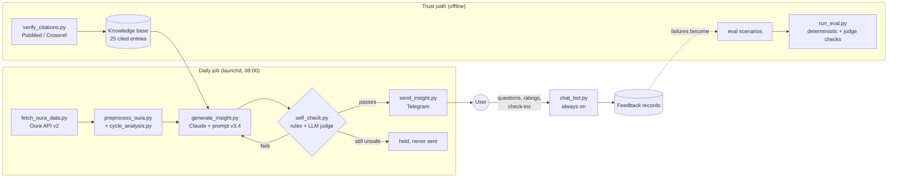

# Cycle Insights

**An LLM pipeline that turns Oura ring data into a short, literature-grounded daily insight about menstrual-cycle recovery, and refuses to send it if it breaks its own safety rules.**

It pulls wearable data every morning, computes personal baselines and cycle phases, asks Claude for one insight grounded in a curated, citation-checked knowledge base, has a second model call review the draft, and delivers it over Telegram. A separate adversarial eval harness checks the same prompt against synthetic edge cases.

Built as a personal tool for a single user. It is not a product or a clinical device.

---

## At a glance

| | |
|---|---|
| **What it does** | Oura API → personal-baseline analysis → grounded LLM insight → self-check → Telegram, on a daily schedule, plus a two-way chat bot |
| **Why it's hard** | Health guidance from an LLM can do real harm, and the wearable's own "good recovery" signal is misleading for the people most likely to use this (see [the problem](#the-problem)) |
| **How trust is built** | Deterministic rule checks, LLM-as-judge review, citation verification against PubMed/Crossref, no-lookahead backtesting, and a held-not-sent path for unsafe drafts |
| **Stack** | Python (mostly stdlib), Anthropic API, Oura API v2, Telegram Bot API, macOS `launchd` / cron |
| **Tests** | 40 offline unit tests on seeded synthetic data; no API keys or personal data needed |

### What this project demonstrates

- **LLM evaluation as a first-class deliverable.** The generating prompt is maybe a third of the work; the rest checks that it follows its own rules: per-rule deterministic checks, single-rule LLM judges with anti-leniency instructions, and adversarial scenarios.
- **Grounding with verification, not just retrieval.** Every knowledge-base entry needs a PMID or DOI, and a verifier resolves them against PubMed and Crossref. That process caught real errors, including fabricated citations (documented in [METHODOLOGY §7](METHODOLOGY.md#7-citation-integrity)).
- **Safety by design.** Guardrails were chosen by subtraction: no diagnoses, no numeric food targets, no body-composition talk, and twelve escalation triggers that route to real clinical care.
- **Data engineering that respects time.** `--as-of` rebuilds the input exactly as it looked on a past date, so retrospective evaluation can't peek at the future.
- **Honest reporting.** Known failures, a voided early metric and unvalidated components are written down in [METHODOLOGY.md](METHODOLOGY.md#6-limitations), not hidden.
- **Privacy-aware operations.** It runs locally on a schedule instead of in public CI, all personal data is gitignored, and tests use a seeded synthetic generator.

---

## The problem

Oura's Readiness score is built largely from resting heart rate, HRV and temperature deviation. For most wearers that's fine. In women with low energy availability it inverts: metabolic suppression produces **low RHR and high HRV**, which is the exact signature Oura reads as excellent recovery ([Melin et al. 2019](https://pubmed.ncbi.nlm.nih.gov/30632422/)). The number that looks best is the one that should prompt concern.

Oura's own validation agrees. [Thigpen et al. 2025](https://pubmed.ncbi.nlm.nih.gov/39889300/) (JMIR) cautions that its ovulation detection was not validated for PCOS and other luteal-phase-deficiency conditions, which are precisely the people most likely to be reading these numbers for answers.

Cycle-tracker apps don't fill the gap either. They predict from calendar history, so for irregular or absent cycles they degrade to guessing.

This project reads the same data and reframes it against the endocrinology literature, in software, where the device's defaults can't.

---

## How it works



| Stage | What happens | Key file |
|---|---|---|
| **1. Pull** | Fetches readiness, sleep, activity, SpO2, stress and user-tagged period days from the Oura API. The new dump only replaces yesterday's if the critical endpoints came back, so an expired token can't silently wipe the data. | `scripts/fetch_oura_data.py`, `scripts/scheduled_pull.py` |
| **2. Preprocess** | Builds a compact markdown summary the prompt consumes: coverage, cycle markers, rolling windows, and a "last 3 nights" table. | `scripts/preprocess_oura.py` |
| **3. Analyse** | Labels each day with cycle day and phase, estimates the temperature shift, and compares recent days with the user's *own* baseline and same-phase baseline in standard deviations. This step is pure arithmetic with no clinical thresholds. | `scripts/cycle_analysis.py` |
| **4. Generate** | Assembles a 16-block system prompt (knowledge base, counter-framings, diagnostic guardrails, escalation triggers, output format) and asks Claude for one insight. | `scripts/generate_insight.py`, `prompts/v3.4.md` |
| **5. Self-check** | Free regex checks run first (diagnostic labels, numeric food targets, causal wording, any number not found in the data or knowledge base). Then one reviewer call grades the draft on seven criteria. Failing drafts are rewritten up to twice, and a draft that still fails a safety check is saved as `held` and never sent. | `scripts/self_check.py` |
| **6. Deliver** | Sends to Telegram. Before a new insight goes out, the bot asks whether yesterday's suggested steps got done. | `scripts/send_insight.py`, `scripts/checkin.py` |
| **7. Chat** | A long-running bot answers follow-up questions under the same guardrails, records ratings, and serves `/weekly` and `/monthly` stats reports computed with no model call. | `scripts/chat_bot.py`, `scripts/period_report.py` |

### The trust path

The product path and the eval harness assemble the prompt through the same module (`scripts/eval/prompt_lib.py`). That is deliberate: an eval that builds the prompt differently from production measures a system nobody runs. That bug happened here once (see [METHODOLOGY §6](METHODOLOGY.md#6-limitations)).

| Check | How | Where |
|---|---|---|
| **Structural rules** | Word count, required callouts, inline citation format, banned phrases, numeric density. Anything a regex can settle is settled by a regex. | `scripts/eval/rules/deterministic.py` |
| **Semantic rules** | LLM-as-judge, one rule per call: chain hallucination (NT2b), the counter-framing firing (CF1), handling of diagnostic ambiguity (DG8), and escalation firing. Each judge must give a binary verdict with verbatim quotes as evidence. | `scripts/eval/rules/judge.py` |
| **Adversarial scenarios** | Ten synthetic data shapes (for example, a healthy baseline the system should *not* over-interpret, or exercise load that crept up). | `scripts/eval/scenarios/` |
| **Citation integrity** | Offline: every entry has a PMID or DOI (runs in the unit tests). Online: each identifier is resolved and its first author and year are compared with the citation. | `scripts/verify_citations.py` |
| **No-lookahead backfill** | `preprocess_oura.py --as-of DATE` drops later days *and* later user-reported events, the same hindsight-stripping discipline as an honest backtest. | `scripts/backfill.py` |

---

## Key engineering decisions

- **Counter-framings over hoping the model knows better.** A general-purpose model shown high HRV and low RHR will congratulate the user. The prompt names the counter-intuitive reading explicitly (CF1–CF6) instead.
- **The human outranks the sensor.** User-reported context beats ring-derived events, because the ring cannot observe a bleed. Conflicts are surfaced, not resolved silently.
- **Refuse to pick between look-alike conditions.** Hypothalamic amenorrhea and lean PCOS can look the same in this data but call for opposite interventions. When the data fits both, the output must name both and point to the workup that would tell them apart.
- **"Direction yes, numbers no" for nutrition.** "More carbohydrate around hard sessions" is in scope. Calories, grams and macros are not, because a number becomes a target to beat.
- **Absence of data is a coverage gap, not a finding.** The pipeline once never requested the endpoint that holds period tags, and the model reasoned from an empty log to a serious conclusion. Every output rule would have scored it clean. The fix was in the data layer, and the lesson is now a prompt rule.
- **Deterministic first, model second.** Regex checks are free, fast and can't be talked out of a verdict. The model is reserved for judgments that need one.
- **Local scheduling, not CI.** The repo is public, so GitHub Actions logs would be too. `launchd` runs it on the user's own machine and catches up after sleep.
- **Stdlib wherever possible.** Only the Anthropic SDK is a third-party dependency, which keeps a fresh clone runnable.

---

## Try it without any accounts

Everything below runs from a fresh clone with Python 3 and no API keys, using seeded synthetic data.

```bash
# Unit tests (cycle analysis, self-check, chat bot, check-ins, citation structure)
python3 -m unittest discover tests

# Citation structure check (add --online on a normal network to resolve every PMID/DOI)
python3 scripts/verify_citations.py

# Assemble the prompt for every eval scenario without calling the API
cd scripts/eval && python3 run_eval.py --all --dry-run && cd ../..

# Run the pipeline on a synthetic 150-day Oura dump
python3 -c "import json,sys; sys.path.insert(0,'tests'); from synthetic_oura import make_dump; json.dump(make_dump(), open('/tmp/demo_oura.json','w'))"
python3 scripts/preprocess_oura.py --input /tmp/demo_oura.json --output /tmp/demo_summary.md
python3 scripts/generate_insight.py --summary /tmp/demo_summary.md --dry-run --no-write
```

In `--dry-run`, the eval reports every check as FAIL because nothing was generated to score. That is expected. Add `ANTHROPIC_API_KEY` to `.env` and drop `--dry-run` for a real run.

---

## Run it on your own data

```bash
cp .env.example .env          # OURA_TOKEN, ANTHROPIC_API_KEY, TELEGRAM_BOT_TOKEN, TELEGRAM_CHAT_ID
python3 -m venv .venv && .venv/bin/pip install anthropic

cd scripts
../.venv/bin/python3 fetch_oura_data.py --days 180
../.venv/bin/python3 preprocess_oura.py
../.venv/bin/python3 generate_insight.py            # daily form; --cadence weekly for the long form
../.venv/bin/python3 send_insight.py --discover-chat-id   # once, after messaging your bot
```

Events Oura's API doesn't return, such as spotting, go in `scripts/user_cycle_log.json` (gitignored; see [`user_cycle_log.example.json`](scripts/user_cycle_log.example.json) for the format).

### Schedule the daily insight (macOS)

`scripts/scheduled_pull.py` does the fetch and preprocess steps unattended, and with `--insight --send` it also generates and sends the insight. It only replaces the old dump when readiness and period tags both came back. Logs go to `logs/scheduled_pull.log`.

The job runs daily at 08:00, or on wake if the Mac was asleep. To pull only, remove the `--insight` and `--send` lines from the plist.

```bash
REPO="$(pwd)"; PY="$REPO/.venv/bin/python3"; mkdir -p logs
sed -e "s|__REPO__|$REPO|g" -e "s|__PYTHON__|$PY|g" \
    scheduling/com.cycleinsights.oura-pull.plist \
    > ~/Library/LaunchAgents/com.cycleinsights.oura-pull.plist
launchctl unload ~/Library/LaunchAgents/com.cycleinsights.oura-pull.plist 2>/dev/null
launchctl load ~/Library/LaunchAgents/com.cycleinsights.oura-pull.plist
launchctl start com.cycleinsights.oura-pull     # run once now to check
tail logs/scheduled_pull.log
```

Linux (cron): `0 8 * * * cd /path/to/cycle-insights/scripts && python3 scheduled_pull.py --insight --send`

For a weekly long-form insight as well, add a second job with `--insight --cadence weekly --send`. It is not scheduled by default.

### Keep the chat bot running (macOS)

`scripts/chat_bot.py` only answers while it is running. This makes it start at login and restart if it stops:

```bash
REPO="$(pwd)"; PY="$REPO/.venv/bin/python3"; mkdir -p logs
sed -e "s|__REPO__|$REPO|g" -e "s|__PYTHON__|$PY|g" \
    scheduling/com.cycleinsights.chat-bot.plist \
    > ~/Library/LaunchAgents/com.cycleinsights.chat-bot.plist
launchctl load ~/Library/LaunchAgents/com.cycleinsights.chat-bot.plist
tail logs/chat_bot.out.log      # should say "Chat bot running."
```

Stop it with `launchctl unload ~/Library/LaunchAgents/com.cycleinsights.chat-bot.plist`. It can't answer while the Mac is asleep, and it catches up on waiting messages when awake. Don't run `poll_feedback.py` at the same time, because both read the same Telegram update cursor.

---

## Repository map

```
prompts/
  v3.4.md                 The current system prompt: 16 blocks, with placeholders
                            where runtime data is injected (v3.1, v3.2 kept for history)
scripts/
  fetch_oura_data.py      Pull raw Oura data (incl. user-tagged period days)
  preprocess_oura.py      Raw dump → the summary the prompt consumes; --as-of gives
                            a no-lookahead historical slice
  cycle_analysis.py       Cycle phase, personal baselines, per-cycle deltas
  generate_insight.py     Product path: data → one insight (runs the self-check)
  self_check.py           Deterministic safety checks + LLM reviewer + rewrite loop
  send_insight.py         Push to Telegram; refuses to send held drafts
  checkin.py              "Did you do yesterday's steps?" flow
  chat_bot.py             Two-way Telegram chat, ratings, /weekly and /monthly
  period_report.py        Model-free weekly / monthly stats
  poll_feedback.py        Replies (or --rate) → structured feedback records
  backfill.py             Retrospective insights over historical data
  scheduled_pull.py       Unattended fetch + preprocess (+ insight, + send)
  verify_citations.py     Knowledge-base citations → PubMed / Crossref
  probe_oura_tags.py      Diagnostic: which Oura tag endpoints return data
  config.py               .env loader, stdlib only
  eval/
    prompt_lib.py         Shared prompt assembly + API call (product and eval)
    run_eval.py           Scenario runner
    rules/deterministic.py  Word count, citation format, banned phrases
    rules/judge.py          LLM-as-judge checks
    scenarios/            One JSON file per synthetic scenario
tests/                    Unit tests + seeded synthetic Oura generator
scheduling/               launchd templates for the daily job and the chat bot
METHODOLOGY.md            Design rationale, eval methodology, limitations
research_notes.md         The curated literature behind the knowledge base
```

Read [METHODOLOGY.md](METHODOLOGY.md) for the full reasoning behind each design choice, and [`scripts/eval/README.md`](scripts/eval/README.md) to add a scenario.

---

## Status and known limitations

Working end to end and runs daily. **Wrong in places, and documented as such.** The full list is in [METHODOLOGY §6–7](METHODOLOGY.md#6-limitations); the headline items are:

- **An early 92% structural pass rate is void.** The scenarios were self-authored, and a harness bug stripped four prompt rules before scoring. It is not cited anywhere.
- **The judges are unvalidated against human labels.** The reviewer is the same model family as the writer, so it can share the writer's blind spots.
- **One rater, unblinded**, apart from blind A/B comparisons between prompt versions.
- **Structural compliance is not clinical correctness.** No credentialed reviewer has been involved.
- **Two knowledge-base tables are qualitative only.** Figures that couldn't be traced to a source were removed rather than kept.

## Privacy

No personal data is in this repository. Raw Oura dumps, generated summaries, insights, chat history, logs and the personal cycle log are all gitignored. Every date and number in the tests and eval scenarios is synthetic, and the example dates in usage strings are placeholders.

## Not medical advice

This tool does not diagnose, and it is designed to refuse to. Where the data fits more than one condition it names them all and points at the workup that would distinguish them. Twelve escalation triggers route to real clinical care rather than continuing to advise.

Nothing here has been reviewed by a clinician. Don't use it as though it has been.
